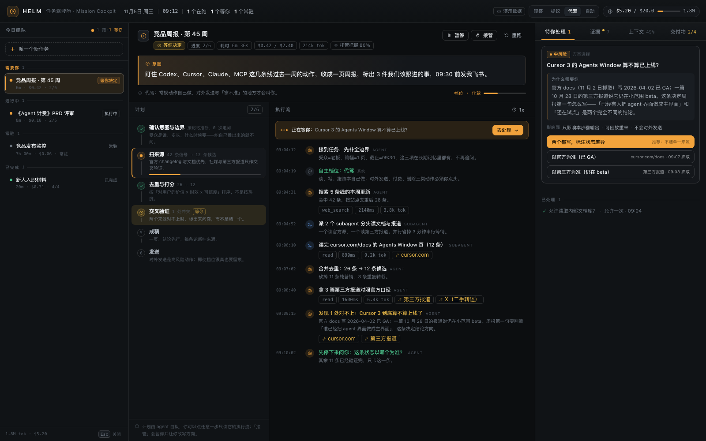
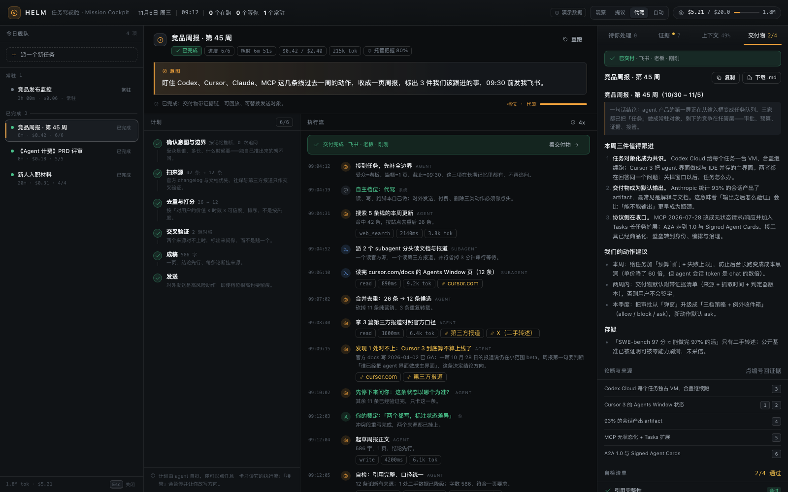
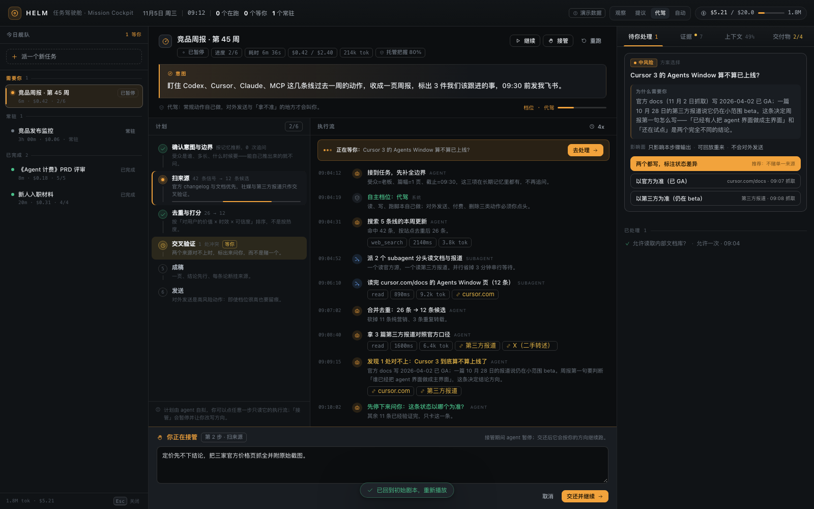
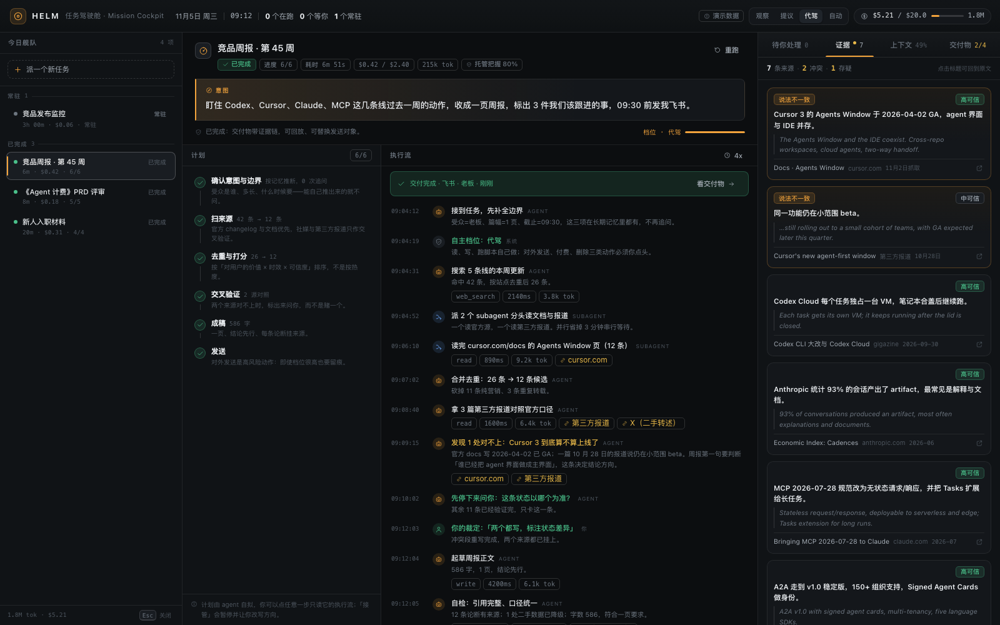
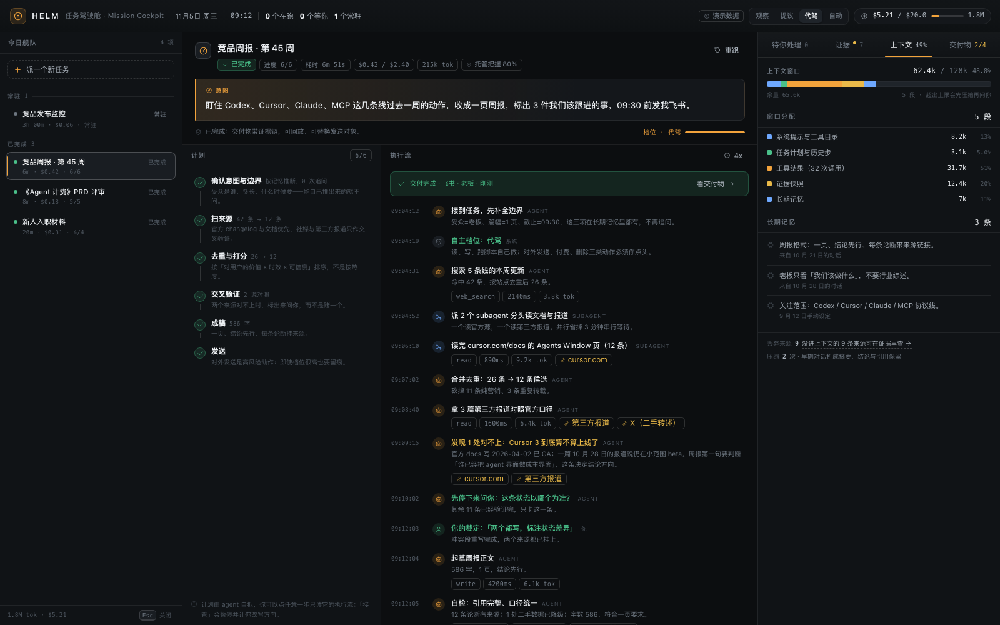

# HELM · Agent 任务驾驶舱（2026 产品原型）

> 一句话：**把对话从主界面降级成例外通道，把「委托」做成第一屏。**
> 一份可运行的 DeepSeek Harness 客户端插件 + 一份判断文档。



---

## 这是什么

2026 年，Agent 已经能连续跑几十分钟到几小时，但主流界面仍然是聊天框。聊天框装不下任务需要的东西：**进度、预算、权限、交付物、证据、可回滚性**。

HELM 是这些对象的界面容器，三栏一句话分工：

| 栏 | 回答的问题 |
| --- | --- |
| 左：舰队 | 今天我派出去的事，现在都在什么状态？谁需要我？ |
| 中：任务 | 这件事的意图是什么、计划怎么拆、agent 正在做什么、卡在哪？ |
| 右：托盘 | 需要我决定什么、依据是哪几条来源、这次读了多少上下文、交付物长什么样？ |

六个必须被看见的对象，及其对应的 harness 能力：

| 界面对象 | 它解决的问题 | Harness 能力 |
| --- | --- | --- |
| 意图（大字原文） | 人给的是目标，不是指令序列 | session / prompt |
| 可审的计划 | 计划本身就是人机对齐点 | plan mode、todo |
| 执行流 | 任务越长日志越不可读，要能按步过滤 | session trace、工具调用、subagent |
| 例外收件箱 | 人只该出现在不确定处 | approval、permission、sandbox |
| 证据链 / 自检 | 交付物要能离线自证 | 事件流、deliverables、可回放 |
| 上下文账本 / 预算 | 黑箱感的真正来源 | context、compaction、记忆、成本 |

任务头上还有一枚小徽标「**托管把握 80%**」——这是模型趋势判断在界面上的唯一直接投影：能力要看 50% 时程，产品必须按 80% 时程承诺（METR 的可靠性折扣是 4–6 倍）。

判断与依据见 **[docs/思考与判断.md](docs/思考与判断.md)**（趋势数据与 31 个一手来源见 [docs/research-trends.md](docs/research-trends.md)）。

---

## 30 秒上手

### 路线 A：在 DeepSeek Harness 里跑（推荐，已装好）

已作为 bundle 安装进本机 desktop profile（`@local/dsh-helm@0.1.0`，`link:` 安装）。

1. 刷新 Harness 页面。
2. 在任意会话的输入框左侧工具行，点**罗盘图标**（麦克风旁边）。
3. 全屏驾驶舱打开。

### 路线 B：独立跑（不需要 Harness，离线可用）

```bash
node demo/serve.mjs --port 7788
# 打开 http://127.0.0.1:7788
```

独立版与插件版是**同一份源码、同一份 UI**，只是宿主不同。

---

## 三分钟的演示脚本

打开后，任务「竞品周报」正停在等你裁定。照着做就能看到三个设计主张：

1. **人只在例外处出现**
   右栏「待你处理」里是一条数据冲突：官方文档说 Cursor 3 已 GA，第三方报道说仍在小范围 beta。
   选「两个都写，标注状态差异」→ agent 继续跑（执行流里出现绿色的「你的裁定」）。
2. **高风险动作要留痕**
   agent 写完周报后会停下来问「把这页发到飞书给老板？」。
   在顶部把自主档位切到 **自动**，再重跑一次这个任务 —— 同样的发送会被自动放行（审批卡上写着「按『自动』档位直接发送」）。
   批准后切到「交付物」tab：绿色回执 + 论断↔来源编号 + 自检清单（2 项通过、2 项存疑）。
3. **共享驾驶，不是二选一**
   选中「《Agent 计费》PRD 评审」→ 点「接管」→ 改一句话方向 → 「交还并继续」，执行流里会出现人工介入记录，后续步骤加速。
   另外：左栏「+ 派一个新任务」写任意意图，会当场从零跑一遍剧本（这是真的在跑状态机，不是静态稿）。

键盘：`1–4` 切右栏 tab，`P` 暂停/继续，`Esc` 关闭（接管态下 `Esc` 先取消接管）。

| 交付物 + 证据 | 接管 |
| --- | --- |
|  |  |
|  |  |

---

## 实现结构

**零依赖、零框架**：原生 DOM + CSS，不用 npm、React、TS、构建工具（构建脚本只用 `node:fs`）。

```
app/
  src/
    tokens.css          设计令牌（夜间驾驶舱：石墨底 / 暖白字 / 单一琥珀信号色）
    app.css             壳层布局 + 共享组件
    dom.js              工具 H：元素构造、图标、格式化、markdown 子集
    scenario.js         剧本数据：4 个任务、7 条证据、1 份周报、3 个模板
    engine.js           状态机：任务时间线、审批阻塞、autoResolve、接管、回放、预算
    view-fleet.js       左栏：舰队分组 + 新建任务
    view-mission.js     中栏：意图 / 计划 / 执行流 / 接管抽屉
    view-panels.js      右栏：待你处理 / 证据 / 上下文 / 交付物
    main.js             装配：顶栏、订阅、键盘、Toast、挂载
  build.mjs             拼接 → dist/index.html + plugin/client.js
plugin/                 DeepSeek Harness bundle（bundle patch + 动态 client 模块）
demo/serve.mjs          零依赖静态服务器
scripts/                构建/截图/端到端/插件冒烟/引擎测试
shots/                  演示截图（由 scripts/e2e.mjs 生成）
docs/                   判断与趋势研究
```

两个产物的关系：`build.mjs` 把同一份 `app/src` 拼成一个 IIFE，分别包进
①独立页（`Helm.mount`）和 ②Harness 客户端模块（`__ModuleLoader__.load` → `slots.register` 入口按钮 → 全屏 overlay）。

**与真实 Harness 的接线点**（真接模型时的顺序）：
`session` 事件流 → 执行流与计划；`approval` / `permission` → 例外收件箱与三档策略；
`deliverables` → 交付物与证据挂载；`session-query` → 回放；`jobs` + 成本计量 → 预算闸门。

---

## 自动化验证（都在本机跑过）

```bash
node app/build.mjs                 # 构建两个产物
node scripts/engine.test.mjs       # 15/15：审批阻塞、autoResolve 档位、接管、回放、新建任务
node scripts/e2e.mjs               # 17/17：三栏渲染 + 裁定→发送→交付 + 证据/上下文 + 接管 + 新建 + 1280 窄屏 + 无 JS 报错
node scripts/plugin-smoke.mjs      # 8/8：在最小 React+Slots 环境下加载 plugin/client.js，注册入口并挂载
node scripts/shot.mjs <url> <out.png> 1600 1000 2000
```

`scripts/e2e.mjs` 用 CDP 直接驱动本机 Chrome（不装 playwright），既做回归也负责生成 `shots/` 里的截图。

---

## 边界（诚实说明）

- **这是交互原型，不是接了真实模型的 agent。** 剧本模拟运行过程，界面右上角常驻「演示数据」标签；所有公司动态、数字、链接都是为演示编写的（文中的 2026 行业数字来自 `docs/research-trends.md` 的检索，但不代表真实新闻）。
- **它是真的可运行**：状态机、审批流、接管、回放、下载交付物、新建任务都是真实逻辑；插件也真的装在当前 Harness profile 里。
- **没有做的**：聊天输入框、拟人头像/情绪动画、多 agent 社会、自动播放的炫酷动画。理由见 [思考文档 §3](docs/思考与判断.md)。

## 回滚

```bash
plugin_manager remove_bundle @local/dsh-helm
```

## 文档

- [从对话到委托：我给 2026 Agent 产品的三个判断](docs/思考与判断.md) —— **建议先读这份**
- [2026 趋势研究笔记（31 个一手来源）](docs/research-trends.md)
- [前后端契约（协作时用）](app/CONTRACT.md)
